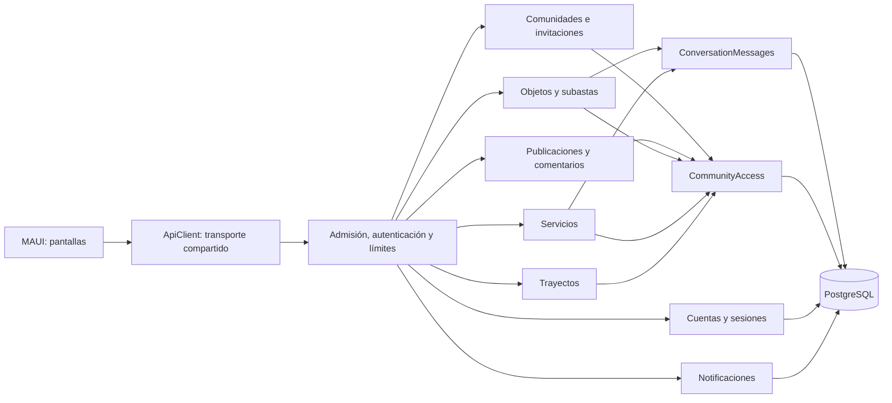

# Arquitectura y revisión técnica

Revisión: 12 de octubre de 2026. La aplicación sigue siendo un monolito modular:
una API, PostgreSQL y un cliente MAUI. Esta distribución permite mantener las
operaciones de comunidad, permisos y mensajes dentro de transacciones locales.

## Responsabilidades

- `AccountEndpoints`: registro, inicio/cierre de sesión y cuenta actual.
- `CommunityEndpoints` y `CommunityMembershipEndpoints`: ciclo de vida,
  pertenencia e invitaciones. Ya no residen en autenticación.
- `MarketEndpoints`: reglas propias de venta, alquiler y subasta.
- `ServiceChatEndpoints`: autorización del servicio y de sus participantes.
- `ConversationMessages`: historial paginado, envíos idempotentes y lecturas.
  Es el mismo código para servicios y objetos.
- `NotificationEndpoints`: bandeja y contador, independientes del mercado.
- `Data`: acceso parametrizado a SQL, acceso a comunidades, proyección de
  publicaciones, almacenamiento de mensajes y migraciones.
- `Infrastructure`: control de concurrencia, errores temporales y limpieza.
- `Contracts`: contratos de transporte y validaciones compartidas existentes.
- `ConversationPage`: pantalla común para conversaciones de objetos y servicios.

Los nombres históricos `market_messages`, `market_conversations` y algunos DTO
se conservan para no introducir una migración destructiva ni romper clientes.
No se añadieron repositorios genéricos ni una capa intermediaria por cada consulta.

## Problemas corregidos

| Problema observado | Cambio y efecto |
| --- | --- |
| Mensajes privados duplicados y servicios acoplados a `MarketEndpoints` | Almacenamiento común de mensajes y módulos de rutas separados. |
| Leer un servicio tomaba un bloqueo exclusivo | Lecturas con bloqueo compartido; los envíos se serializan por conversación. |
| Enviar mensajes o marcar lecturas de objetos competía con las pujas | Autorización del chat independiente de la mutación del objeto. |
| Archivado concurrente sin una protección uniforme | Acceso común con bloqueo de comunidad durante la transacción. |
| Invitaciones con orden de bloqueo incompatible con el archivado | Orden comunidad → invitación → pertenencia. |
| Límites de API compartidos por todos los usuarios de una IP | Presupuesto de API por cuenta; autenticación mantiene su límite por IP. |
| Trabajo simultáneo sin límite antes de consultar sesiones | Límite de admisión por instancia, sin cola ilimitada. |
| Consultas que seguían trabajando tras cancelar la petición | Propagación del `CancellationToken` hasta PostgreSQL en las rutas. |
| Esperas largas o errores opacos ante bloqueos/caídas | Presupuestos de conexión/consulta/bloqueo y respuesta temporal 503. |
| Readiness comprobaba únicamente que PostgreSQL respondiera | También valida que el registro de migraciones coincida con la API. |
| Migraciones repetidas en una lista de código y un número de test | Catálogo derivado de SQL embebido y comprobación dinámica en las pruebas. |
| Campana descargaba títulos y mensajes de hasta 50 conversaciones | Ruta de contador; la bandeja completa se pide al abrirla. |
| Un `HttpClient` nuevo por pantalla de cuenta | Transporte compartido con autorización en cada petición. |
| Sesiones caducadas crecían indefinidamente | Limpieza periódica de lotes de hasta 1000 sesiones. |
| Índices insuficientes para accesos por comunidad/participante | Migración 011 aditiva con índices de acceso y caducidad. |

## Invariantes de concurrencia

Las operaciones de contenido toman primero un bloqueo `SHARE` de la comunidad
activa. Archivar o restaurar modifica esa misma fila, por lo que espera a las
operaciones ya aceptadas; las peticiones que esperaban a un archivado confirmado
vuelven a evaluar el acceso y se rechazan. No basta con consultar el permiso fuera
de la transacción.

El servicio se protege con `SHARE` para no retirarlo durante una operación privada.
Los envíos toman `FOR UPDATE` de su conversación: dos interesados distintos no
se bloquean entre sí. Esto mantiene el orden de confirmación de los mensajes
dentro del chat y evita que un marcador de lectura omita un mensaje anterior que
todavía no se había confirmado. Los marcadores solo avanzan con `GREATEST`.

Las pujas mantienen el bloqueo exclusivo del objeto, comprueban el incremento
y vuelven a comprobar el plazo con la hora real de PostgreSQL al insertar.
Los administradores no obtienen acceso a conversaciones ajenas.

## Disponibilidad y despliegue

- `Availability:MaxConcurrentRequests`: 64 por instancia por defecto. Rechazo
  inmediato con 503 y `Retry-After: 2`; liveness queda fuera de esta admisión.
- API: 120 peticiones/minuto por cuenta. Autenticación: 20/minuto por IP.
  Ambos contadores son locales a cada instancia.
- Sesiones del piloto: token de dispositivo en SecureStorage, con 180 días de
  validez y renovación cuando quedan 179 días o menos. El uso habitual conserva
  el acceso, sin escribir la sesión en cada sondeo. La inactividad de unos seis
  meses exige identificarse de nuevo. También se renuevan las sesiones antiguas
  que todavía sean válidas; nunca se recuperan sesiones caducadas o revocadas.
  La contraseña no se guarda en el teléfono. Cambiar de dispositivo, borrar los
  datos o cerrar sesión requiere volver a entrar; la recuperación sin contraseña
  sigue pendiente. No se envían correos ni se verifica su titularidad en el piloto.
- Si no se especifican en la cadena de conexión: conexión de hasta 5 segundos,
  comando de hasta 10 segundos y opciones PostgreSQL `lock_timeout=5000` y
  `statement_timeout=10000`. Una configuración explícita prevalece.
- Migraciones: presupuesto de comando de 120 segundos y espera por bloqueo
  de hasta 10 segundos, dentro de una transacción y con bloqueo asesor.
- Desarrollo aplica migraciones al arrancar. Fuera de desarrollo, hacerlo es
  explícito; ejecutar una vez el binario con `--Database:MigrateOnly=true`
  y la misma conexión configurada, antes de poner la nueva API en servicio.
  `Database:MigrateOnStartup=true` sigue disponible cuando se decide usarlo.
- `/health/live`: proceso vivo. `/health/ready`: conexión y esquema compatibles.
  El balanceador debe retirar del tráfico una instancia que no esté lista.
- Docker Compose reinicia PostgreSQL con `unless-stopped`. El volumen conserva
  los datos; **no constituye una copia de seguridad**.
- `scripts/Backup-Database.ps1` genera una copia consistente con `pg_dump` en
  `.artifacts/backups` (fuera de Git), comprueba que PostgreSQL puede leer su
  catálogo y conserva intacta la base original. Contiene datos privados; debe
  protegerse y trasladarse a almacenamiento externo según la política elegida.
  Leer el catálogo no demuestra que la restauración completa funcione.
- Las sesiones caducadas se limpian cada cinco minutos en lotes acotados con
  `SKIP LOCKED`. Si falla PostgreSQL, se registra el fallo y se intenta en el
  siguiente ciclo. No se eliminan mensajes, usuarios ni invitaciones históricas.

No se reintentan automáticamente escrituras tras una pérdida de conexión: la
respuesta podría haberse perdido después de confirmar la transacción. Mensajes,
comentarios, objetos, trayectos y pujas conservan sus identificadores idempotentes.
Las publicaciones simples todavía requieren comprobar el listado antes de repetir.

## Verificación reproducible

`scripts/Test-Posts.ps1 -Suite` acepta `accounts`, `posts`, `comments`, `lifecycle`,
`market`, `rides`, `services` y `architecture`. Crea bases temporales, comprueba
persistencia tras reiniciar y no usa los datos de la comunidad real.

La suite de arquitectura fuerza bloqueos reales en PostgreSQL y comprueba:
lecturas compartidas, conversaciones independientes, envíos concurrentes sin
duplicación, archivado concurrente con publicaciones/comentarios/invitaciones,
saturación controlada sin perder liveness, timeout recuperable, coherencia del
contador, esquema pendiente y presupuestos independientes para cuentas en la
misma IP. Usa cuatro plazas de admisión para poder saturar de forma controlada.
También ejecuta las migraciones como proceso independiente sobre una base vacía
y arranca después la API con las migraciones automáticas desactivadas.

`scripts/Test-Api.ps1` cubre base sin configurar y base inaccesible. La compilación
Android valida los contratos y el cliente. Estas pruebas no sustituyen una
medición de carga sostenida ni permiten afirmar una cifra de usuarios soportados.

En esta revisión se ejecutaron las ocho suites y las comprobaciones de base sin
configurar/inaccesible. Se compiló el cliente Android y se restauró la copia local
autorizada en una base temporal, eliminada al terminar la comprobación. La base
local quedó en la versión 11 con la API lista. No había un emulador conectado al
cerrar la revisión, por lo que no se instaló el cliente en esta última validación.
La compilación final de API terminó sin errores, con aviso NU1900: no se pudo
consultar el servicio de vulnerabilidades de NuGet; esa auditoría queda pendiente.

## Límites que siguen requiriendo trabajo

1. **Operación de producción:** aún no hay un despliegue con varias instancias,
   PostgreSQL con conmutación automática, copias externas verificadas, objetivos
   de recuperación ni alertas de latencia/errores. Hay un solo servidor de datos.
2. **Varias réplicas:** el límite global debe resolverse en el proxy o una solución
   compartida; configurar proxies de confianza antes de interpretar IP reenviada.
   La base compartida permite sesiones sin afinidad, pero los límites actuales
   no son distribuidos. El total de conexiones de todos los procesos debe caber
   en PostgreSQL; ajustar admisión y pool conjuntamente.
3. **Volumen:** las fichas aún incluyen toda su lista de conversaciones, y la
   lista de comunidades no está paginada. Requieren nuevos contratos paginados
   y adaptación de las pantallas antes de admitir volúmenes grandes.
4. **Notificaciones:** siguen siendo sondeo mientras la pantalla está activa.
   El contador reduce transferencia, pero sigue contando mensajes no leídos;
   medir planes y latencias antes de introducir contadores materializados o push.
5. **Cliente:** algunas páginas siguen uniendo estado y construcción de vistas.
   La siguiente separación útil es extraer sesión/navegación de `AccountPage`
   y formularios de sus páginas, con pruebas del ciclo de vida; cambiar solo
   nombres de archivos no resolvería ese acoplamiento.
6. **Migraciones:** son transaccionales y conservadoras. La comprobación exacta
   del esquema no promete despliegues graduales sin interrupción. Para eso se
   necesitan contratos compatibles entre versiones y migraciones por fases.
7. **Catálogo:** las fotos pequeñas viajan en el listado; a mayor volumen conviene
   separar miniatura/detalle y medir la transferencia. La tabla del antiguo
   prototipo de reservas se conserva sin uso para no destruir datos históricos.

Estos límites son explícitos: la refactorización corrige fallos comprobados del
código, pero no convierte el entorno local en una plataforma de alta disponibilidad.

## Web como cliente principal

La web de vecinos incluye los módulos existentes de Android, incluidos Trayectos,
Animales, Compraventa y la papelera de comunidades. Android queda en pausa.

La migración 014 añade límite y contador a las invitaciones, con actualización
atómica bajo el mismo bloqueo de invitación que la incorporación de miembros.
La revocación invalida el código sin retirar membresías ya creadas.

La migración 015 añadió usuarios únicos. La 016 vuelve a email como identificador
de acceso, conservando los datos históricos de usuario y las contraseñas. El correo
es obligatorio en registro, acceso y actualización de perfil; las filas anteriores
sin correo se conservan hasta que su titular lo complete. El operador de plataforma
solo puede asignar correo a cuentas que carecen de él, con auditoría y sin cambiar
contraseñas. El nombre visible deja de ser un identificador de autenticación.